# Problema 4: banca con identidades y procesadores

## Qué problema resuelve

En el diseño inicial, `BankingService` termina tomando decisiones sobre las identidades, las operaciones y los bancos. Eso hace que la clase crezca cada vez que aparece un caso nuevo. Mi propuesta separa esas responsabilidades para que cada tipo de identidad y operación pueda aplicar sus propias reglas, y cada adaptador pueda ocuparse de su banco.


## Cómo organicé el diseño

### Identidades

La clase abstracta `Identidad` contiene lo que comparten los cuatro tipos. De ella heredan `IdentidadPersonal`, `IdentidadEmpresa`, `IdentidadMenor` y `IdentidadResidenteExtranjero`. Cada una tiene sus propios documentos y revisa su regla particular: por ejemplo, la empresa pide aprobación si se supera el umbral; el menor necesita tutor; y el residente extranjero no puede operar con el permiso vencido.

Las operaciones permitidas, los límites y los procesadores autorizados se guardan en `PoliticaIdentidad`. Así, el límite de 2.000 o el umbral de 10.000 se pueden cambiar en la configuración sin buscar y editar varios `if` dentro de `ServicioBancario`. Para un menor, la política solo permite el Banco Nacional.

### Operaciones

También usé una clase abstracta, `Operacion`, con una clase para cada caso: depósito, retiro, transferencias nacional e internacional, y nómina. Esto evita poner campos que no aplican a todos: por ejemplo, el BIC solo pertenece a una transferencia internacional y las cuentas de empleados solo a una nómina.

Cada operación puede validar sus datos y calcular el total. En una nómina, el total es el pago por empleado multiplicado por la cantidad de cuentas. Un depósito devuelve cero como consumo del límite diario.

### Dónde se usa el polimorfismo

El servicio usa los tipos comunes `Identidad`, `Operacion` y `ProcesadorPago`. Estas son las llamadas donde el objeto concreto decide qué comportamiento ejecutar:

### Ejemplo de las lineas del codigo de como se ve el polimorfismo 
```java
ResultadoValidacion validacion = identidad.validarOperacion(operacion, fecha, procesador.obtenerId());
Dinero total = operacion.calcularTotal();
ResultadoProcesador resultado = procesador.procesar(identidad, operacion);
```

En la primera llamada, la subclase de `Identidad` aplica sus propias reglas; por ejemplo, la identidad de un menor comprueba que tenga tutor. En la segunda, si `operacion` es una nómina, `calcularTotal()` multiplica el pago por empleado por la cantidad de cuentas. En la tercera, el adaptador concreto llama al método del banco que envuelve. Las tres llamadas usan un tipo común y dejan que la implementación concreta determine el comportamiento; por eso no hace falta un `switch` para escoger la clase.

### Adaptadores para los bancos

Cada adaptador tiene el mismo método para el servicio, pero por dentro llama al método que ya trae el banco. Usé los nombres del código del problema:

| Adaptador propio | API externa que envuelve | Adaptación de respuesta |
| --- | --- | --- |
| `AdaptadorBancoNacional` | `NationalBankProcessor.postTransaction(...)` | Convierte la referencia o `null` en un resultado uniforme. |
| `AdaptadorBancoPacifico` | `PacificBankProcessor.submit(...)` y `submitPayroll(...)` | Convierte importes a centavos y transforma `REJECTED:<reason>` en un rechazo uniforme. |
| `AdaptadorPasarelaSwift` | `SwiftGatewayProcessor.sendWire(...)` | Captura el error de datos de la API y lo convierte en un rechazo uniforme. |

El adaptador traduce la solicitud y la respuesta; no cambia el código de `NationalBankProcessor`, `PacificBankProcessor` ni `SwiftGatewayProcessor`. Para la nómina, Pacífico recibe el monto en centavos por empleado y la lista de cuentas. El límite y la comisión se calculan usando el total de la nómina.

### Tarifas

`RepositorioConfiguracion` carga los límites y las tarifas. Los valores del enunciado son la configuración inicial, no números escritos directamente en el servicio. Las fórmulas son: Banco Nacional `0`; Banco Pacífico `total × 0,005`; SWIFT `25 + 1 % del total si la moneda no es USD`. El cargo fijo de SWIFT debe estar en la misma moneda que el importe; el enunciado no dice cuál es esa moneda.

### Qué hace `ServicioBancario`

1. Comprueba que la identidad elegida pertenezca al usuario.
2. Valida la identidad, la operación y el procesador.
3. Calcula el total y comprueba el límite diario.
4. Calcula la tarifa y llama al adaptador elegido.
5. Registra el resultado y, si fue una operación saliente aceptada, actualiza el consumo diario.

El límite se lleva por identidad, fecha y moneda. Se acepta una salida cuando `consumido + importe <= límite`. El depósito no suma al acumulado.

## Comprobación de cálculos

Ejemplo, suponiendo que la identidad no haya consumido antes su límite diario: nómina empresarial de 3 empleados a 4.000 USD por empleado.

- Total: `4.000 × 3 = 12.000 USD`.
- Límite: consume 12.000 USD; cabe dentro del límite de empresa de 50.000 USD.
- Aprobación: se requiere porque `12.000 > 10.000`.
- Comisión Pacífico: `12.000 × 0,005 = 60 USD`.
- Llamada a `submitPayroll`: envía 400.000 centavos por empleado y las 3 cuentas; no envía el total como si fuera el pago individual.

Como comprobación del borde, 2 empleados a 5.000 USD dan exactamente 10.000 USD y no requieren aprobación: la regla dice “superior a 10.000”. Un depósito tampoco aumenta el uso del límite. Los importes se guardan en unidades menores (centavos para USD) para evitar errores de redondeo.

El enunciado no aclara la moneda del cargo fijo SWIFT ni la conversión de divisas. No se deben sumar importes en monedas distintas: la moneda del cargo debe configurarse y cualquier conversión requiere una política y tasa explícitas.

## Diagrama de clases

El diagrama fuente también está en [diagrama-bancario.mmd](diagrama-bancario.mmd).

```mermaid
classDiagram
    class Usuario {
        +Cadena id
        +Cadena nombre
        +Lista~Identidad~ identidades
    }
    class Identidad {
        <<abstract>>
        +Cadena id
        +Cadena cuenta
        +PoliticaIdentidad politica
        +validarOperacion(Operacion op, Fecha hoy, Cadena procesador) ResultadoValidacion
        #validarReglasEspecificas(Operacion op, Fecha hoy) ResultadoValidacion
    }
    class IdentidadPersonal {
        +Cadena documentoNacional
        #validarReglasEspecificas(Operacion op, Fecha hoy) ResultadoValidacion
    }
    class IdentidadEmpresa {
        +Cadena identificacionFiscal
        +Cadena nombreEmpresa
        #validarReglasEspecificas(Operacion op, Fecha hoy) ResultadoValidacion
    }
    class IdentidadMenor {
        +Cadena documentoNacional
        +Cadena idTutor
        #validarReglasEspecificas(Operacion op, Fecha hoy) ResultadoValidacion
    }
    class IdentidadResidenteExtranjero {
        +Cadena pasaporte
        +Cadena pais
        +Fecha venceResidencia
        #validarReglasEspecificas(Operacion op, Fecha hoy) ResultadoValidacion
    }
    class PoliticaIdentidad {
        +Conjunto~TipoOperacion~ operacionesPermitidas
        +Dinero limiteDiario
        +Dinero umbralAprobacion
        +Conjunto~Cadena~ procesadoresPermitidos
    }
    class Operacion {
        <<abstract>>
        +Cadena id
        +TipoOperacion tipo
        +Dinero importe
        +validarDatos() ResultadoValidacion
        +calcularTotal() Dinero
        +consumoLimite() Dinero
    }
    class Deposito {
        +validarDatos() ResultadoValidacion
        +consumoLimite() Dinero
    }
    class Retiro {
        +validarDatos() ResultadoValidacion
    }
    class TransferenciaNacional {
        +Cadena cuentaDestino
        +validarDatos() ResultadoValidacion
    }
    class TransferenciaInternacional {
        +Cadena cuentaDestino
        +Cadena bic
        +validarDatos() ResultadoValidacion
    }
    class Nomina {
        +Lista~Cadena~ cuentasEmpleados
        +calcularTotal() Dinero
        +validarDatos() ResultadoValidacion
    }
    class TipoOperacion {
        <<enumeration>>
        DEPOSITO
        RETIRO
        TRANSFERENCIA_NACIONAL
        TRANSFERENCIA_INTERNACIONAL
        NOMINA
    }
    class Dinero {
        +Entero64 unidadesMenores
        +Cadena moneda
    }
    class ResultadoValidacion {
        +Booleano valido
        +Lista~Cadena~ errores
    }
    class ResultadoOperacion {
        +Booleano exitosa
        +Cadena referencia
        +Cadena error
        +Dinero comision
    }
    class ResultadoProcesador {
        +Booleano aceptado
        +Cadena referencia
        +Cadena codigoRechazo
    }
    class ConfiguracionProcesador {
        +Cadena id
        +Booleano habilitado
        +Conjunto~TipoOperacion~ operacionesSoportadas
        +Dinero cargoFijo
        +Entero tasaPuntosBase
        +Cadena monedaCargo
        +Booleano tasaSoloSiNoUSD
    }
    class CalculadoraComision {
        +calcular(Dinero total, ConfiguracionProcesador config) Dinero
    }
    class RepositorioConfiguracion {
        +obtenerPolitica(Cadena tipoIdentidad) PoliticaIdentidad
        +obtenerProcesadores() Lista~ConfiguracionProcesador~
    }
    class ProcesadorPago {
        <<interface>>
        +obtenerId() Cadena
        +procesar(Identidad identidad, Operacion operacion) ResultadoProcesador
    }
    class AdaptadorBancoNacional {
        -NationalBankProcessor apiExterna
        +procesar(Identidad identidad, Operacion operacion) ResultadoProcesador
    }
    class AdaptadorBancoPacifico {
        -PacificBankProcessor apiExterna
        +procesar(Identidad identidad, Operacion operacion) ResultadoProcesador
    }
    class AdaptadorPasarelaSwift {
        -SwiftGatewayProcessor apiExterna
        +procesar(Identidad identidad, Operacion operacion) ResultadoProcesador
    }
    class NationalBankProcessor {
        <<externo, no modificable>>
        +postTransaction(cuenta, tipo, importe, contraparte) Cadena
    }
    class PacificBankProcessor {
        <<externo, no modificable>>
        +submit(referencia, codigo, centavos, destino) Cadena
        +submitPayroll(referencia, cuentas, centavosPorEmpleado) Cadena
    }
    class SwiftGatewayProcessor {
        <<externo, no modificable>>
        +sendWire(cuentaOrigen, cuentaDestino, bic, importe, moneda) Cadena
    }
    class SelectorProcesador {
        +seleccionar(Cadena id, Identidad identidad, Operacion operacion) ProcesadorPago
    }
    class RegistroLimitesDiarios {
        +consumido(Cadena identidadId, Fecha fecha, Cadena moneda) Dinero
        +registrarSalida(Identidad identidad, Fecha fecha, Dinero importe) Vacio
    }
    class RegistroAuditoria {
        +registrar(Operacion op, ResultadoOperacion resultado) Vacio
    }
    class ServicioBancario {
        +ejecutar(Usuario usuario, Identidad identidad, Operacion op, Cadena procesadorId) ResultadoOperacion
    }

    Identidad <|-- IdentidadPersonal
    Identidad <|-- IdentidadEmpresa
    Identidad <|-- IdentidadMenor
    Identidad <|-- IdentidadResidenteExtranjero
    Operacion <|-- Deposito
    Operacion <|-- Retiro
    Operacion <|-- TransferenciaNacional
    Operacion <|-- TransferenciaInternacional
    Operacion <|-- Nomina
    ProcesadorPago <|.. AdaptadorBancoNacional
    ProcesadorPago <|.. AdaptadorBancoPacifico
    ProcesadorPago <|.. AdaptadorPasarelaSwift

    Usuario "1" *-- "1..*" Identidad : posee
    IdentidadMenor "0..*" --> "1" Usuario : tutor
    Identidad --> PoliticaIdentidad : aplica
    Operacion --> TipoOperacion
    Operacion *-- Dinero : importe
    ConfiguracionProcesador *-- Dinero : tarifa
    RepositorioConfiguracion ..> PoliticaIdentidad : carga
    RepositorioConfiguracion ..> ConfiguracionProcesador : carga
    AdaptadorBancoNacional --> NationalBankProcessor : envuelve y llama postTransaction
    AdaptadorBancoPacifico --> PacificBankProcessor : envuelve y llama submit o submitPayroll
    AdaptadorPasarelaSwift --> SwiftGatewayProcessor : envuelve y llama sendWire
    SelectorProcesador ..> ProcesadorPago : selecciona por id y compatibilidad
    SelectorProcesador ..> ConfiguracionProcesador : consulta
    ServicioBancario ..> RepositorioConfiguracion
    ServicioBancario ..> CalculadoraComision
    ServicioBancario ..> SelectorProcesador
    ServicioBancario ..> RegistroLimitesDiarios
    ServicioBancario ..> RegistroAuditoria
    ServicioBancario ..> Operacion : coordina
    ServicioBancario ..> ResultadoOperacion : produce
    ServicioBancario ..> Identidad : valida polimorficamente
    ServicioBancario ..> Operacion : calcula polimorficamente
    ServicioBancario ..> ProcesadorPago : invoca polimorficamente
    CalculadoraComision ..> ConfiguracionProcesador : obtiene tarifa
    AdaptadorBancoPacifico ..> Dinero : convierte a centavos
```


